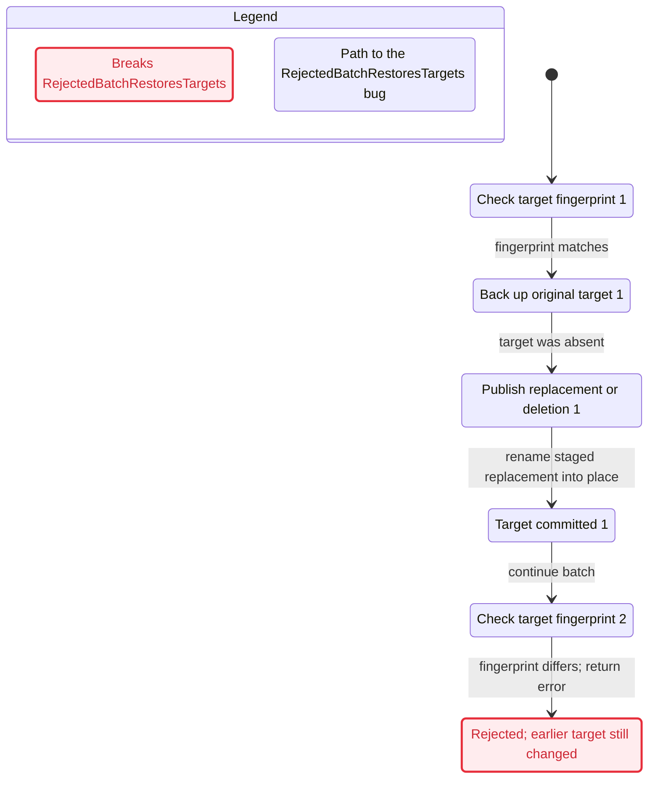
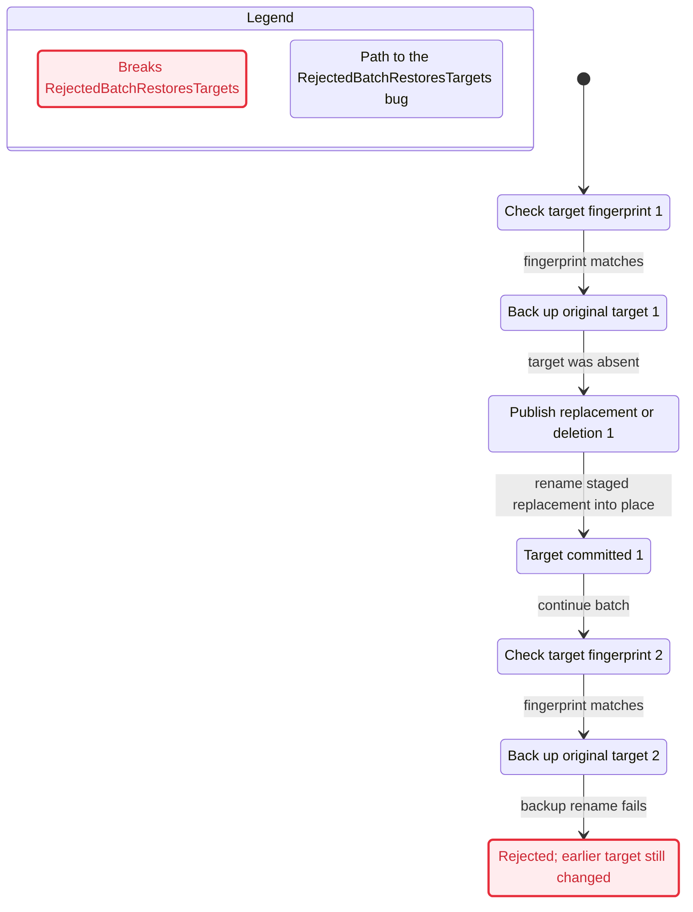

# Projection batch baseline

Product sync: `18d08435258e3b8915354f32150a1f7df8dee536`.

Tracking: verification [#901](https://github.com/yersonargotev/packy/issues/901); product defect [#902](https://github.com/yersonargotev/packy/issues/902). The verification PR closes only #901.

## Confirmed implementation finding

`ApplyFilesystemChanges` can return a stale-precondition error after an earlier target was committed, without calling `rollbackFilesystemChanges`. The fingerprint-error and fingerprint-mismatch returns are above the branches that perform rollback on backup/publication errors. Failed-batch cleanup removes staging paths but leaves earlier published targets and their backups.

One concrete replay, `present-3_replace-3_stale-2_fault-none`:

1. `target-1` contains `baseline-1`; `target-2` contains `baseline-2`.
2. Both replacement payloads stage successfully. Target 1's expected fingerprint matches; target 2's expected fingerprint differs.
3. Packy renames target 1 to its `.packy-batch-stage-….backup` and publishes `replacement-1` at target 1.
4. Target 2 fails its fingerprint comparison. Packy returns `target changed after preflight`.
5. Target 1 still contains `replacement-1`; target 2 retains `baseline-2`. Target 1's original bytes remain in the backup rather than at their original path.

The user sees a failed operation with part of the projection batch already changed. This is reproducible with no concurrent writer, no rollback failure, and no process crash. Product code was left unchanged because generation of the verification did not authorize fixing it.

The bounded real-code matrix executes 320 cases and reports **44 failing cases** with this same cause. Fault selections whose injection point is unreachable can repeat the same path; 44 does not mean 44 distinct defects. The fresh-precondition cases, including the backup/publication failure controls, pass.

TLC/$statechart explored **1,568 reachable model states** in the full bounded model and found the same invariant violation. The shortest path has five steps: check target 1; skip its backup because it was absent; publish target 1; advance to target 2; reject target 2's stale fingerprint. The exact path is replayed by `present-0_replace-1_stale-2_fault-backup-1`; the selected backup fault is unreachable and has no effect.

## Mutation control

`--self-test` isolates fresh preconditions. Its real-code control has two present files, two replacements, and a one-shot backup rename failure on target 2. Correct rollback restores target 1; the control passes.

The fresh-precondition TLC control completes all **784 reachable states** without an invariant violation.

The scratch overlay changes the backup-error branch to call `rollbackFilesystemChanges(items[:0])`. The code still compiles and returns the injected error, but target 1 retains replacement bytes. The matching model mutation sets `RollbackOnBackupFailure` false. Both checks must fail `RejectedBatchRestoresTargets`; restoring the unmodified control must pass again. The complete run then checks the original model and all 320 replay cases, preserving the known stale-precondition finding.

## Evidence and interpretation

The runner retains scratch inputs, TLC output, structured Go test events, readable replay output, and `summary.json` outside the repository. Run `$statechart` on each copied model/config/view to interpret every model result, including the fresh control and mutant when using `--self-test`.

TLC checks the hand-written transaction model. The Go replay checks the actual executor's bounded inputs and injected rename boundaries. Their agreement supports this concrete finding; it does not establish a proof of every Go execution, filesystem, or payload type. Coverage and exclusions are in [the skill](../SKILL.md).

The tool versions and checksums come from the [TLA+ 1.7.4 release](https://github.com/tlaplus/tlaplus/releases/tag/v1.7.4) and the [Temurin 21.0.13+9 release](https://github.com/adoptium/temurin21-binaries/releases/tag/jdk-21.0.13%2B9). The [TLC configuration reference](https://docs.tlapl.us/using:tlc:config_file) describes invariant checks and their configuration.

## Baseline counterexample

## Scratch mutation counterexample

These charts show only the shortest bug paths; other reachable transitions are omitted by `$statechart` because the state spaces exceed its 500-state chart budget. The passing control has 784 reachable states and therefore produces a report without a chart.

## Validation completed

The generated skill was followed with `--self-test`: the control passed, both model and actual Go mutation failed, the unmodified control passed again, and the complete baseline returned only the known stale-precondition finding. `go test ./...` passed with sandboxed HOME/config roots and the formal tag excluded. Skill frontmatter validation passed. No product code changed.
